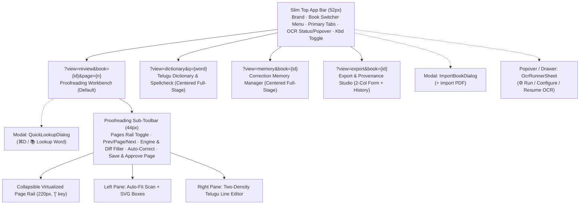

# Browser UI/UX Redesign Proposal — Telugu Book Digitizer

**Assessment Type:** Read-Only Product & Frontend UI/UX Audit and Redesign Architecture  
**Evaluated Frontend Version:** `telugu-digitizer-ui@0.3.0` (`frontend/`)  
**Date:** 2026-11-28  

---

## 1. Executive Summary

**Telugu Book Digitizer** has strong domain capabilities—dual-engine Telugu OCR (PaddleOCR PP-OCRv5 + Tesseract 5), non-destructive raw OCR preservation, scan-to-line bounding-box synchronization, an integrated 195k+ headword Telugu dictionary, contextual correction memory, a custom InScript/Phonetic virtual keyboard, and validated `.docx`/`.txt` export. Its warm paper-and-teal palette and Telugu font stack also provide an appropriate foundation for archival reading.

However, as features were added across Phases 2 through 5, every new capability was appended into a single permanent multi-panel screen (`frontend/src/App.tsx`, 1,520 lines) and a two-layer stylesheet (`frontend/src/styles/app.css`, 2,299 lines). As a result, **the interface suffers from severe vertical banner stacking, permanent setup chrome, quadrupled status/action elements, and heavy per-line form cards**:

1. **The "7-Banner Squeeze" (P0):** On a loaded book, seven horizontal bars stack above the actual page scan and text (`CommitmentBar`, `app-header`, `WorkflowStepper`, 4 `OverviewCards`, `OcrProgressStrip`, `status-banner`, and 2–3 wrapped toolbar rows), consuming **~440–480 px (>50% of a 900 px laptop viewport)** and creating **up to 5 nested vertical scrollbars** on one screen.
2. **Proofreading Card Exhaustion (P0):** Every OCR line on a 30-line Telugu page renders a ~260–320 px form card with badges, a full-width `Raw OCR (immutable)` box (even when 100% identical to the editable text below it), a multi-line `<textarea>`, a memory checkbox, and 5–6 action buttons—producing **~180–210 interactive controls and ~8,000 px of vertical scrolling per page**.
3. **Permanent Setup Sidebar & Redundant Controls (P0/P1):** A fixed `275–325 px` left sidebar permanently displays PDF upload, duplicate book lists (`<ul>` list *plus* `<select>` dropdown *plus* `Switch Book →`), and OCR engine configuration—even during active proofreading or inside the standalone Dictionary and Correction Memory views. Primary actions (`+ Import PDF`, `Resume OCR`, `Export DOCX / TXT`, `Auto-Sync`, `⌨ Keyboard`) appear **2 to 4 times simultaneously**.
4. **Critical State, Accessibility & Tablet Traps (P0/P1):** Changing the toolbar `Page review status` dropdown to `Approved` discards unsaved line edits; `<polygon role="button" tabIndex={0}>` overlays create 30+ invisible-focus Tab stops between panes; `bookId` and `pageNumber` are lost on browser refresh; and viewports `<= 1024 px` stack ~1,500 px of sidebar forms above the scan, breaking side-by-side proofreading on tablets and phones.

### Core Redesign Strategy
Rather than cosmetic restyling, this proposal restructures the UI around **progressive disclosure and task-focused density**:
- **Reclaim ~360 px of vertical height** by replacing the 7 stacked header/overview bands with a **52 px Top Application Bar** + a **44 px Proofreading Sub-Toolbar**, moving one-time setup tasks (**Import PDF**, **Run OCR Engines**) into dedicated modal/drawer flows, and collapsing page navigation into a toggleable virtualized rail.
- **Cut proofreading visual noise by ~70%** with a **Two-Density Line Editor**: resting lines render as compact, scannable ~48 px single-line rows (no duplicated Raw OCR box or repeated 6-button bars), while only the **currently active line** expands to reveal an inline Telugu *akshara*-level diff, correction suggestions, and action controls—backed by full keyboard-first navigation (`↑`/`↓`, `⌘/Ctrl+Enter`, `⌘/Ctrl+Shift+Enter`).
- **Enable real tablet/mobile proofreading** via a **Pinned Line-Crop Strip** that slices the active bounding box from the page scan directly above the active `<textarea>` on narrow screens.

---

## 2. Overview of the Existing UI

### 2.1 Frontend Stack & Styling Architecture
| Layer | Current Implementation | Source Files |
|---|---|---|
| **Framework** | React `19.0.0` + TypeScript `5.7.3` + Vite `6.1.0` | `frontend/package.json` |
| **Component Library** | None (custom semantic HTML5 `<dialog>`, `<search>`, `<progress>`, `<details>`, inline SVG overlays) | `frontend/src/components/*.tsx` |
| **PDF Rendering** | Lazy-loaded `pdfjs-dist@^4.10.38` + server-rasterized 300 DPI PNGs | `frontend/src/components/SourcePageViewer.tsx:7-20` |
| **Styling** | Single vanilla CSS stylesheet (**2,299 lines**) split across original Phase 2–4 rules (`lines 1–1422`) and `"Studio theme v2"` overrides (`lines 1423–2299`), supplemented by **45+ inline `style={{...}}` blocks** | `frontend/src/styles/app.css`, `frontend/src/**/*.tsx` |
| **Routing / State** | Monolithic top-level `useState` in `App.tsx` (**1,520 lines**, ~26 state variables); partial query-param sync (`?view=dictionary\|memory\|export`, `?q=...`) via `window.history.replaceState` | `frontend/src/App.tsx:62-157` |
| **Test Suite** | Vitest `3.x` + Testing Library + `jsdom` (8 test files, 24 component tests) | `frontend/src/components/*.test.tsx` |

### 2.2 Target Users & Primary Workflows
From `docs/00-product-brief.md` and `docs/18-standalone-telugu-dictionary-plan.md`, the browser UI serves **two distinct user personas**:
1. **Book Digitizers & Proofreaders** (scholars, archivists, volunteers, and guest contributors):
   - **Stage 1 — Import:** Upload a scanned or born-digital Telugu PDF (often 100–500 pages) with title/author/orthography metadata.
   - **Stage 2 — Run OCR:** Run Tesseract 5 (fast draft, ~0.4s/page) and/or PaddleOCR PP-OCRv5 (high-accuracy neural OCR, ~90s/page on CPU), optionally testing pages 1–5 first, monitoring progress, pausing/resuming partial runs.
   - **Stage 3 — Proofread & Approve (90%+ of user session time):** Compare each page scan against extracted Telugu lines, inspect low-confidence or engine-disagreement flags, run optional Dictionary/Memory page auto-correct, fix OCR glyph/matra/ottu errors using physical keys or the Telugu virtual keyboard, mark headings/verse/noise roles, and approve pages sequentially.
   - **Stage 4 — Export:** Generate and download validated page-preserving `.docx`, editable-flow `.docx` (with TOC), or UTF-8 `.txt` plus JSON provenance manifests.
2. **Standalone Dictionary & Spelling Users** (guest visitors on `lahari.org/telugu?view=dictionary` or proofreaders mid-book):
   - Search 195k+ Telugu headwords and C.P. Brown / Wiktionary / Janapada definitions by Telugu script, English meaning, or Latin transliteration; batch spell-check pasted Telugu text; curate custom Telugu vocabulary.

### 2.3 Inventory of Existing Screens & Components
| Screen / Component | File & Size | Role in Current UI |
|---|---|---|
| **Global Shell & Sidebar** | `src/App.tsx` (1,520 L) | Top commitment bar, app header, permanent left sidebar (upload + books + OCR runner + pages list), main stage router, polling loop |
| **Chrome, Stepper & Hero** | `src/components/StudioChrome.tsx` (429 L) | `CommitmentBar`, 4-step `WorkflowStepper`, 4 `OverviewCards`, empty-library `WelcomeHero` + 6 feature cards |
| **OCR Status & Telemetry** | `src/components/OcrStatusBar.tsx` (355 L) | `HeaderOcrStatusPill` + `OcrProgressStrip` (live progress/ETA, paused warning, OCR-required prompt, ready strip) |
| **PDF Upload Form** | `src/components/BookUploadForm.tsx` (189 L) | Drag-and-drop file input, title, author, orthography profile, training consent |
| **Source Scan Viewer** | `src/components/SourcePageViewer.tsx` (438 L) | Page Prev/Jump/Next, `Scan + Boxes` (PNG + clickable SVG `<polygon>`s) vs `PDF.js` canvas, sync button, zoom controls |
| **Proofreading Editor** | `src/components/ReviewEditorPanel.tsx` (1,254 L) | Editor toolbar, manual line insertion box, born-digital `<textarea>`, list of memoized `ReviewBlockCard`s |
| **Telugu Dictionary** | `src/components/DictionaryPanel.tsx` (797 L) | 3 sub-modes: `Search Dictionary` (2-column master/detail), `Check Telugu Text`, `Custom Words` |
| **Quick Lookup Modal** | `src/components/QuickLookupDialog.tsx` (236 L) | Native `<dialog>` for looking up a selected word without leaving Page Review |
| **Correction Memory** | `src/components/CorrectionMemoryPanel.tsx` (242 L) | Search/filter form + sticky-header responsive `.cm-table` with Disable/Enable and Promote to Global |
| **Document Export** | `src/components/ExportPanel.tsx` (264 L) | Format/layout/version/run/font form + list of generated exports with Download & Sidecar JSON links |
| **Telugu Virtual Keyboard** | `src/components/TeluguKeyboard.tsx` (411 L) | Bottom-docked `InScript` + `Phonetic (Roman → Telugu)` composer and matra/varga grid |
| **Delete Confirm Modal** | `src/components/DeleteConfirmDialog.tsx` (85 L) | Native `<dialog>` component (currently unused in `App.tsx` after guest book-switcher update) |

### 2.4 Visual Evidence Inspected
Four actual browser screenshots from this conversation workspace were examined alongside the source code:
- **Empty / Onboarding State (`lahari.org/telugu/`):** Shows `CommitmentBar`, `app-header` (with `No Book Loaded`, `⌨ Telugu Keyboard`, `+ Import PDF`, and 4 view tabs), open `Upload Printed Telugu PDF` sidebar card with raw browser file input, `Books (0)`, and `WelcomeHero` + 6 feature cards.
- **Loaded Book Workspace — Page 1 (`Amuktamalyada Vo.1`, 406 pages):** Shows all stacked banners (`CommitmentBar` → `Header` → `Stepper` → 4 `StatCards` → `Ready` strip) above `SourcePageViewer` + `ReviewEditorPanel` (`Born-Digital Text Path`), alongside the full left sidebar (`Library Import`, `Books (1)`, `Run OCR Engines`).
- **Loaded Book Workspace — Page 7 (Scrolled Sidebar + Status Banner):** Shows `status-banner` adding yet another horizontal bar, dual multi-row pane toolbars, and `Pages (406)` pushed below the fold inside the sidebar with its own nested scrollbar.
- **Single Proofreading Block Card (`Line 13`):** Shows badge row, beige `Raw OCR (immutable)` box, focused `<textarea>`, `Save to correction memory` checkbox, and two wrapped rows of 5 action controls (`Save Correction`, `Approve Block`, `Paragraph ▾`, `Ignore Box`, `Revert to Raw OCR`) plus `Revision history (1)`.

### 2.5 What Works Well and Must Be Preserved
1. **High-Contrast Warm Archival Palette:** Primary text (`--ink: #1b2b28` on `--bg: #f6f2e8`) achieves **13.2:1** WCAG AAA contrast; muted text (`--ink-muted: #52625e` on `--surface: #ffffff`) achieves **6.43:1**; primary buttons (`#ffffff` on `#0f6b5c`) achieve **6.41:1**. The warm cream background significantly reduces glare during multi-hour Telugu proofreading sessions compared to stark `#ffffff` backgrounds.
2. **First-Class Telugu Script & Input Engineering:**
   - Dedicated `--font-telugu` stack (`Kohinoor Telugu`, `Noto Serif Telugu`) with `line-height: 1.6–1.65` prevents clipping of stacked *ottulu* (subjoined conjuncts) and top vowel signs.
   - Explicit `lang="te"` attributes across Telugu text nodes and inputs.
   - Proper IME composition guards (`if (e.nativeEvent.isComposing) return` at `ReviewEditorPanel.tsx:290, 873`).
   - Thoughtful `TeluguKeyboard` focus preservation (`onMouseDown={(e) => e.preventDefault()}`) so clicking on-screen Telugu keys does not blur the active `<textarea>`.
3. **Strong Modern Web Primitives:** Native `<dialog>` modals (`showModal()`), `<search>` landmarks, `@container (width < 600px)` responsive table cards (`.cm-table`), `prefers-reduced-motion` and `forced-colors` media queries (`app.css:1152-1186, 2003-2030`), coarse-pointer 44 px minimum tap targets (`app.css:110-115`), and `field-sizing: content` auto-growing textareas.
4. **Trustworthy Proofreading Safeguards:** Non-destructive editing, preserving unsaved typing drafts during background OCR polling (`ReviewEditorPanel.tsx:568-587`), preview-before-commit Page Auto-Correct chips, and in-context Quick Dictionary Lookup (`QuickLookupDialog.tsx`).

---

## 3. Current UI/UX Problems and Evidence

### 3.1 Visual Design & Information Hierarchy
1. **Severe Vertical Chrome Stacking ("7-Banner Squeeze"):**
   - *Evidence:* In `App.tsx:905-981` and `1359-1404`, when a book is loaded in Page Review, the browser stacks `CommitmentBar` (`32 px`) + `.app-header` (`62 px`) + `WorkflowStepper` (`54 px`) + `OverviewCards` (`108 px`) + `OcrProgressStrip` (`56 px`) + `.status-banner` (`44 px`) + wrapped `.pane-toolbar` rows (`88–124 px`). Even on a 1440×900 screen, **444–480 px of vertical height is consumed by headers and dashboards**, leaving barely 400 px for the 406-page scan and editor.
2. **Quadrupled Information & Competing Primary CTAs:**
   - *Evidence:* On a loaded book screenshot, **four** green/prominent CTAs compete simultaneously: `+ Import PDF` (header), `+ Import PDF` (sidebar), `Run Selected OCR` (sidebar), `Export DOCX / TXT` (ready strip), and `Approve Page` (editor toolbar). Book title, engine readiness, `Resume OCR`, and `Export` each appear in **3 to 4 places at once**. When everything is emphasized with badges, icons, colored borders, and primary green fills, nothing stands out.
3. **Redundant Raw OCR Text & Button Clutter on Every Line:**
   - *Evidence:* `ReviewBlockCard` (`ReviewEditorPanel.tsx:159-164, 352-434`) renders `.raw-ocr-box` unconditionally—even on the ~80–90% of lines where `block.current_text === block.raw_text` and no edits exist—forcing the user's eye to read every Telugu line twice. Below each `<textarea>`, 5–6 buttons/selects render on **every** card (`Save Correction`, `Approve Block`, `Layout Role`, `Ignore Box`, `📚 Dictionary`, `Revert to Raw OCR`), creating ~180+ buttons on a single 30-line page.
4. **Split CSS Theme Layers (`v1` vs `v2`) & Raw File Input Chrome:**
   - *Evidence:* `app.css` defines `.app-header`, `.brand-mark`, `.panel-card`, `.sidebar`, `.pane`, and `.pane-toolbar` in lines `171–715`, then overrides their radii, shadows, and backgrounds in `"Studio theme v2"` (`lines 1423–1592`), alongside 45+ inline `style={{...}}` objects (`App.tsx:988, 1002, 1055, 1155`, `ReviewEditorPanel.tsx:169, 194, 1010`, `ExportPanel.tsx:234`). In `BookUploadForm.tsx:97-108`, the native `<input type="file">` renders raw OS chrome (`[Browse... No file...lected.]`) directly inside the custom `.file-dropzone`.

### 3.2 Usability & Workflow Friction
1. **Silent Data-Loss Trap Between `Page review status` Select and `Approve Page` Button:**
   - *Evidence:* `ReviewEditorPanel.tsx:1053-1095` places `<select aria-label="Page review status">` right next to `Save All (N) & Approve Page`. Typing corrections updates local `drafts` state (`ReviewEditorPanel.tsx:598`). If the user selects `Approved` from the status dropdown instead of clicking `Save All & Approve Page`, `handlePageStatusChange("approved")` (`App.tsx:584-609`) calls `PATCH .../review-status` and `refreshReview(...)` **without submitting `dirtyBlocks`**—wiping out or stranding unsaved edits!
2. **Duplicate Book Switchers & Four Import Triggers:**
   - *Evidence:* `App.tsx:1028-1104` renders `<ul className="book-list">` buttons for every book, and immediately inside the *same* `Books` card renders `<select aria-label="Select another book">` containing the exact same books, plus `Switch Book →` (which cycles `idx + 1` blindly) and `+ Upload Another Book`. On the empty state (`books.length === 0`), `WelcomeHero`'s `"Import your first PDF"` CTA sits right next to the already-expanded `Upload Printed Telugu PDF` sidebar form.
3. **Confusing Dual Save Model (Per-Card Save vs Page Batch Save):**
   - *Evidence:* Editing 4 lines on a page lights up 4 separate `Save Correction` buttons *and* changes the top-right button to `Save All (4) & Approve Page`. Clicking `Save Correction` on a single card triggers a full network reload of `listBookPages` + `listBookOcrRuns` + `getPageReview` (`App.tsx:519-522`), whereas `Auto-Correct Page` stages edits in `drafts` expecting batch save. Users lack a clear, low-friction "edit lines freely, auto-save or commit smoothly" flow.
4. **Irrelevant Sidebar Context in Dictionary, Memory, and Export Views:**
   - *Evidence:* `App.tsx:984-1356` renders `<aside className="sidebar">` (`Library Import`, `Books`, `Run OCR Engines`, `Pages (406)`) unconditionally across `activeView === "dictionary"`, `"memory"`, and `"export"`. A guest opening `?view=dictionary` sees 300 px of PDF/OCR controls unrelated to dictionary lookup.
5. **Misleading Hosting Copy & Lost Navigation State on Reload:**
   - *Evidence:* `CommitmentBar` (`StudioChrome.tsx:12`) states `"🔒 Runs 100% on this machine"` even when accessed by remote guests over `https://lahari.org/telugu/`. Meanwhile, `selectedBookId` and `selectedPageNumber` are not reflected in the URL (`App.tsx:100-112`), so refreshing the browser on Page 180 resets to Book 1, Page 1; and `history.replaceState` breaks the browser Back button across views.
6. **Missing Line-to-Line Keyboard Flow & Character-Level Engine Diff:**
   - *Evidence:* Proofreaders only have `Ctrl/Cmd+Enter` inside a `<textarea>` (`ReviewEditorPanel.tsx:291`) and `Ctrl/Cmd+Z`. There are no shortcuts to move to the next/previous line (`Alt+↓`/`Alt+↑`), jump to the next flagged issue, or advance pages (`Alt+→`/`Alt+←`). When PaddleOCR and Tesseract disagree (`ReviewEditorPanel.tsx:166-190`), full strings are stacked with no character/*akshara* highlight, forcing manual glyph-by-glyph visual hunting.

### 3.3 Responsive Behavior (`Desktop`, `Tablet`, `Mobile`)
1. **Nested Scrollbars on Desktop/Laptop (`> 1024 px`):**
   - *Evidence:* `.app-shell` fixes `block-size: 100dvh` (`app.css:163`), `.main-stage` sets `overflow-y: auto` (`app.css:354`), and `.main-stage > .review-split` sets `min-block-size: min(36rem, 72dvh)` (`app.css:1590`). Because `OverviewPanel` + `OcrProgressStrip` + `status-banner` push `.review-split` past `100dvh`, scrolling the mouse wheel scrolls `.main-stage` or `.pane-body` unpredictably depending on cursor position, while `.sidebar` and `.page-list` (`max-block-size: 22rem`, `app.css:1005`) create two more scrollbars on the left.
2. **1,500 px Sidebar Tower Above Content on Tablet & Mobile (`<= 1024 px`):**
   - *Evidence:* At `@media (max-width: 1024px)` (`app.css:763-804`), `.workspace-grid` switches to `grid-template-columns: 1fr` with `<aside className="sidebar">` first in DOM order and `overflow-y: visible`. Tablet and mobile users must scroll past `Library Import`, `Books`, `Run OCR Engines`, and `Pages` on every page interaction before reaching `<main>`.
3. **Broken Side-by-Side Proofreading on `<= 960 px`:**
   - *Evidence:* `@media (max-width: 960px)` (`app.css:685-690`) stacks `SourcePageViewer` (`max-block-size: 75dvh`) vertically above `ReviewEditorPanel` (`max-block-size: 75dvh`). Proofreading Line 22 requires scrolling up 600 px to read the scan, memorizing the Telugu phrase, and scrolling down 600 px to type it—made worse when `TeluguKeyboard` (`max-block-size: 38dvh`, `position: sticky; bottom: 0`) covers nearly 40% of the viewport.
4. **Hardcoded `760 px` Base Scan Width Causes Horizontal Clipping at `"100%"` Zoom:**
   - *Evidence:* `SourcePageViewer.tsx:105` computes `displayWidth = Math.round(760 * zoom)` regardless of container width! On a 1280 px laptop, the scan pane inside `.review-split` after a 300 px sidebar is only `~470 px` wide—meaning `"100%"` zoom immediately overflows horizontally by ~290 px unless the user manually clicks `Fit`.

### 3.4 Accessibility Audit
1. **30+ Invisible-Focus SVG Polygon Tab Stops (P0 Accessibility Defect):**
   - *Evidence:* `SourcePageViewer.tsx:403-419` puts `tabIndex={0}` and `role="button"` on every `<polygon>` in `.overlay-svg`, while `app.css:79` scopes focus rings to `:where(a, button, input, select, textarea):focus-visible`—omitting `polygon` / `[tabindex]:focus-visible`! Keyboard users pressing `Tab` after the Scan toolbar lose their visible focus indicator completely for 30+ presses before reaching the Editor toolbar.
2. **Low Non-Text Border Contrast on Interactive Cards/Controls (WCAG 1.4.11):**
   - *Evidence (Measured Contrast Ratios):*
     - `--border: #ddd6c3` on `--surface: #ffffff` = **1.45:1** (used as the sole resting border on interactive `.book-item-btn`, `.dict-result-btn`, `.step-body`, `.block-card` — well below WCAG 2.1 AA **3.0:1** for interactive UI boundaries).
     - `--info-border: #4fae9c` on `--info-bg: #e5f3ef` = **2.34:1** (used on `.autocorr-btn`, `.sync-trigger-btn`, `.kbd-key-sign`).
     - By contrast, `--border-strong: #8c8672` on `#ffffff` achieves **3.64:1** (passes AA).
3. **Inconsistent ARIA Navigation Roles & Duplicate `<h1>` Landmarks:**
   - *Evidence:* `App.tsx:944` (`segmented-nav`) and `DictionaryPanel.tsx:343` (`dict-subnav`) use `aria-pressed` toggle buttons for mutually exclusive view switching instead of WAI-ARIA `role="tablist"`/`role="tab"` (which `TeluguKeyboard.tsx:134` *does* implement) or `aria-current="page"`. Meanwhile, `QuickLookupDialog.tsx:104` and `DeleteConfirmDialog.tsx:68` use `<h1>` for modal titles while `.app-header h1` is already on screen.
4. **Polite Live Region on Error Banners:**
   - *Evidence:* `App.tsx:1387-1393` renders `.status-banner` with `role="status" aria-live="polite"` even when `banner.kind === "error"`. Critical upload, OCR, or save failures should use `role="alert"` (`aria-live="assertive"`) or focus management so screen-reader users hear failures immediately, and visual toast/banner feedback should remain visible regardless of scroll position.

### 3.5 Frontend Performance & Perceived Responsiveness
1. **Confirmed in Source Code (Observed):**
   - **Monolithic `App` re-render blast radius (`App.tsx:62-1520`):** Updating `liveStatuses` (every 1.5s during OCR), `keyboardTargetLabel` (on `focusin`), or `selectedBlockId` re-executes `App()` and reconciles the entire sidebar including all `filteredPages.map(...)` items (`406+` `<li><button>` elements) and `OverviewPanel`.
   - **Unvirtualized `Pages` list & `ReviewBlockCard` action trees:** A 500-page book renders 500 multi-badge buttons in `.page-list`; a 35-line page renders ~200+ buttons/inputs/selects simultaneously even though the user edits one line at a time.
   - **Redundant full-book re-fetches on single-line edits (`App.tsx:519-522`):** Saving one block calls `listBookPages(bookId)` + `listBookOcrRuns(bookId)` + `getPageReview(...)` sequentially before clearing `busyBlockId`, adding avoidable round-trip latency on remote/Pi connections when `BlockEditResponse` already returns the updated block text, role, and `page_review_status`.
   - **Stale image ghosting during page navigation (`SourcePageViewer.tsx:367-382`):** Navigating from Page 7 to Page 8 immediately renders Page 8's SVG bounding boxes over Page 7's dimmed (`opacity: 0.55`) `` until `/pages/8/image` finishes downloading/rasterizing.
2. **Potential Improvement Requiring Runtime Profiling (Unconfirmed Without Large-Page Trace):**
   - `background-attachment: fixed` with 3 layered CSS gradients on `body` (`app.css:1427-1434`) can trigger full-viewport repaint cost during scroll on lower-powered integrated GPUs/tablets; profiling in Chrome DevTools Rendering/Performance tab should confirm repaint impact.

---

## 4. Recommended Design Principles

1. **Content-First Viewport Budget:** At least **80% of viewport height and width** during proofreading must belong to the source scan and Telugu text—never to static marketing banners, setup forms, or repeated KPI cards.
2. **Progressive Disclosure by Task Stage:** Show *Import* controls when importing, *OCR Engine* configuration when launching/adjusting OCR, and *Line Editing* tools on the **active line** being edited—hiding setup machinery once its job is done.
3. **Single Canonical Home per State & Action:** Every status indicator (active book, OCR run state, page approval ratio) and every action (`Import PDF`, `Run/Resume OCR`, `Export`, `Auto-Sync`, `Keyboard`) has **one predictable home** in the chrome.
4. **Zero-Trap Non-Destructive Proofreading:** Preserve raw OCR immutability while eliminating accidental data-loss traps—unifying draft saving and page approval, highlighting *only* actual text differences (*akshara* diffs), and making revert/history effortlessly accessible without cluttering clean lines.
5. **Keyboard-First & Script-Faithful Ergonomics:** A proofreader should be able to review an entire 30-line Telugu page without touching the mouse—moving line-to-line, toggling scan sync, accepting suggestions, typing combining marks, and approving the page via predictable shortcuts while respecting Telugu IME composition.
6. **Adaptive Cross-Device Continuity:** Rather than stacking two 75vh panes vertically on tablets/phones, adapt the scan-to-text relationship using a **Pinned Synchronized Line-Crop** so mobile/tablet reviewers always see the exact scanned line directly above their cursor.

---

## 5. Proposed Application Layout and Navigation

### 5.1 Comparison of Redesign Approaches

| Criterion | Approach A: Incremental CSS Tightening (Keep Permanent 3-Pane Shell) | **Approach B (Recommended): Focused Workbench + Modal/Drawer Setup + Two-Density Line Editor** | Approach C: Separate Step-by-Step Wizard Pages |
|---|---|---|---|
| **Viewport reclaimed** | Low (~80 px) | **High (~360 px vertical + ~300 px horizontal when rail collapsed)** | High, but loses quick cross-tool access |
| **Dictionary / Memory / Export clarity** | Poor (irrelevant Book/OCR sidebar remains visible) | **Excellent (clean full-width centered layouts)** | Good |
| **Line-by-line proofreading speed** | Unchanged (still 30 tall cards × 6 buttons) | **Transformative (compact scannable rows; only active row expands)** | Moderate |
| **Tablet / Mobile usability** | Broken (sidebar tower + stacked 75vh panes) | **Strong (drawer rail + pinned line-crop above active input)** | Moderate |
| **Implementation risk** | Low | **Low-to-Medium (reuses 100% of existing REST APIs & state logic)** | High (rewrites all navigation & state) |

**Recommendation:** Adopt **Approach B**. It preserves every existing backend contract and domain safeguard while directly eliminating the root causes of visual clutter and interaction fatigue.

### 5.2 Proposed Information Architecture & URL Structure



### 5.3 Desktop Proofreading Wireframe (Before vs. After)

#### Before (Current: ~460 px Vertical Chrome + 300 px Permanent Sidebar)
```text
+-----------------------------------------------------------------------------------+
| [Runs 100% on machine] [Raw OCR never overwritten] [No silent fix] [lahari.org]   | 32px
+-----------------------------------------------------------------------------------+
| [తె] Telugu Book Digitizer   [✓ OCR Ready] [⌨ Kbd] [+ Import] [Review|Dict|Mem|Ex]| 62px
+--------------------+--------------------------------------------------------------+
| Library Import     | (1 Import) -> (2 OCR) -> (3 Review 1/406) -> (4 Export) [▴]  | 54px
| [+ Import PDF]     | +-------------+ +-------------+ +-------------+ +----------+ |
|--------------------| | BOOK        | | OCR ENGINES | | PROGRESS 0% | | PAGE 7   | | 108px
| Books (1)          | +-------------+ +-------------+ +-------------+ +----------+ |
| [Amuktamalyada...] | [✓ Ready Amuktamalyada...   [Resume Paddle] [Export DOCX]]   | 56px
| Select book [v]    | [Status banner: Resumed PaddleOCR...                    [x]] | 44px
| [Switch] [+Upload] | +----------------------------+ +---------------------------+ |
|--------------------| | [Prev][7]/406[Next][Scan..] | | Editor [Eng v][Flagged]  | |
| Run OCR Engines    | | [- 100% + Fit Reset]       | | [A-][A+][Sync][Auto][Kbd] | | 105px
| [x] PaddleOCR      | |----------------------------| | [Pending v][Approve Page] | |
| [x] Tesseract      | |                            | |---------------------------| |
| Start [1] End[406] | |   (Only ~380px height      | | [Line 1][Conf][Low][Find] | |
| [Run Selected OCR] | |    left for actual scan!)  | | Raw OCR: గ అష్టాదశ...     | |
|--------------------| |                            | | [Textarea               ] | |
| Pages (406) (inner | |                            | | [Save][Approve][Para][Ign]| |
|  scroll buried!)   | +----------------------------+ +---------------------------+ |
+--------------------+--------------------------------------------------------------+
```

#### After (Proposed: 96 px Total Top Chrome + Maximized Dual-Pane Canvas)
```text
+-----------------------------------------------------------------------------------+
| [తె] Digitizer  [📖 Amuktamalyada Vo.1 ▾] │ [Proofread] [Dictionary] [Memory] [Export] │ [⚙ OCR: Ready ▾] [⌨] [ⓘ] | 52px
+-----------------------------------------------------------------------------------+
| [☰ Pages] [←] Page [ 7 ] / 406 [→]  12/406 ✓ │ Engine: [PaddleOCR ▾] [⚠ 3 Issues · Next] │ [✨ Auto-Correct] [✓ Save & Approve Page] | 44px
+------------+----------------------------------+-----------------------------------+
| Filter:    | [Scan+Boxes|PDF] [Auto-Sync:On]  | [🔍 Filter lines…]  [A− A+] [↶ ↷] | 36px
| [All|Pend] |                        [- Fit +] |-----------------------------------|
|------------|----------------------------------|  1 ✓  శ్రీకృష్ణదేవరాయల ఆముక్తమాల్యద   | 44px (Resting)
| ● p.1  Dig |                                  |  2 ✓  ప్రథమాశ్వాసము - ఉపోద్ఘాతము       | 44px (Resting)
| ● p.2  ✓   |                                  | +-------------------------------+ |
| ◐ p.7  ◀   |     Full-height, auto-fit        | | 3 ⚠ Low Conf (37%) · ⇄ Diff  | | Active
| ○ p.8  ⚠3  |     source page scan             | | Raw diff: [గ ]అష్టాదశవర్[ధ→ణ]నలు| | Expanded
| ○ p.9      |     (~760px vertical height      | | +---------------------------+ | | Card
| ○ p.10     |      on a 900px laptop!)         | | | అష్టాదశవర్ణనలు - 43         | | |
| (Virtual   |                                  | | +---------------------------+ | |
|  scroll,   |                                  | | [✓ Save & Next ⌘↵] [Para ▾]   | |
|  collapse  |                                  | |              [📚 Dict] [⋯ More]| |
|  with '[') |                                  | +-------------------------------+ |
|            |                                  |  4    రాయలవారి కవితా వైభవము          | 44px (Resting)
+------------+----------------------------------+-----------------------------------+
```

---

## 6. Page-by-Page Redesign Recommendations

### 6.1 Global Application Shell & Header (`App.tsx`, `StudioChrome.tsx`)
- **Remove permanent `CommitmentBar` from top of workspace:** Move the 4 core commitments (`Raw OCR never overwritten`, `No silent auto-correction`, `Source PDF stored read-only`, and context-aware `Self-hosted / Local processing`) into the `WelcomeHero` onboarding screen and a subtle `ⓘ Data & Fidelity Guarantees` popover button in the top header.
- **Unify Global Header (`52 px` single row):**
  - **Left:** Brand mark + **Book Switcher Popover/Dropdown** (`📖 Amuktamalyada Vo.1 (406p) ▾`). Opening it lists all books with search, page/approval counts, and `+ Import New PDF…` at the bottom—replacing **all three** redundant sidebar book widgets (`Books` list, `Select another book` select, `Switch Book →`) and duplicate `+ Import PDF` buttons!
  - **Center:** Primary `role="tablist"` navigation (`Proofread`, `Dictionary`, `Memory`, `Export`) with badge counts where helpful (e.g., `Export` enabled state).
  - **Right:** `⚙ OCR Status / Runner` pill button (shows live spinner + `42%` when running, `⚠ Partial` when paused, `✓ OCR Ready` when complete; clicking opens the OCR Popover/Drawer), `⌨` Telugu Keyboard toggle, and `ⓘ` Help/Shortcuts button (`?` key).
- **Replace top-of-flow `.status-banner` with a Floating Bottom-Right Toast + Error Alert Banner:** Transient successes (`"Saved line 3"`, `"Copied word"`) appear as non-layout-shifting auto-dismissing toasts (`4s`, hover-pausable); only actionable errors (`role="alert"`) pin beneath the sub-toolbar so the layout never jumps vertically on every save.

### 6.2 Onboarding Empty State & Book Import Modal (`WelcomeHero`, `BookUploadForm.tsx`)
- **When `books.length === 0`:** Hide the empty left sidebar completely! Center a clean, focused two-column onboarding card: left side explains the 4-step Telugu digitization workflow and core fidelity guarantees; right side embeds the **Drop PDF to Begin** upload card directly—eliminating the awkward state where `"Import your first PDF"` merely clicks a file input 200 px to its left.
- **When `books.length > 0`:** Trigger `+ Import PDF` as a native modal `<dialog>` (`ImportBookDialog`).
- **Fix File Dropzone Visuals:** Visually hide the native `<input type="file" className="sr-only-file-input">` behind a styled `<label>` dropzone displaying an upload icon, `"Drop Telugu PDF here or Choose PDF"`, max upload size (`up to 200 MB · 1,000 pages`), and a clean file chip (`📄 Amuktamalyada.pdf · 18.4 MB · [Change]`) once selected. Group `Author`, `Orthography profile`, and `Training consent` inside a collapsible `Optional book metadata ▾` section so importing a book takes **2 interactions** (Drop PDF → Click `Import Book`, since title auto-fills from filename!).

### 6.3 OCR Execution & Live Telemetry (`OcrStatusBar.tsx`, Sidebar `Run OCR Engines`)
- **Move `Run OCR Engines` out of the permanent sidebar into `OcrRunnerDrawer` / Popover:**
  - Automatically open when a newly imported scanned book has `0` OCR runs, or when the user clicks `⚙ OCR` in the header or `Run OCR` on an un-OCR'd page.
  - Present clear **Preset Cards** instead of raw technical jargon:
    1. **Quick Draft (Recommended first):** *Tesseract 5 Telugu (~0.4s/page — whole book in ~3 min)*
    2. **5-Page Accuracy Sample:** *PaddleOCR PP-OCRv5 + Tesseract on Pages 1–5*
    3. **High-Accuracy Dual OCR:** *PaddleOCR PP-OCRv5 + Tesseract (Custom page range or full book)*
  - Keep `Scan Preprocessing`, `DPI`, `Force re-run`, and `Include digital pages` in the `Advanced` disclosure.
- **Slim Live Progress Strip (`36 px`):** Show the horizontal progress bar *only* when an OCR job is actively `running`, `queued`, or `partial/failed`—collapsing it completely once OCR is `completed` (eliminating the permanent green `✓ Ready ... [Export DOCX]` banner).

### 6.4 Proofreading Workbench: Page Rail, Scan Viewer & Two-Density Line Editor
1. **Unified Proofreading Sub-Toolbar (`44 px`):**
   - Consolidates page navigation (`[☰ Pages]` `[←]` `Page [7] / 406` `[→]` + `12/406 Approved` progress pill) on the left and page-level editorial actions (`Engine` selector, `⚠ Flagged (3) · Next Issue`, `✨ Auto-Correct Page`, and one unified primary CTA `✓ Save & Approve Page`) on the right.
   - **Eliminate the data-loss status `<select>` trap:** Replace the separate `Pending / In Review / Needs Attention / Approved` dropdown + competing `Approve Page` button with a single split-action: primary button `✓ Save & Approve Page` (which always saves any dirty drafts first!) plus a secondary flag button `⚑ Needs Attention` (which also saves dirty drafts before marking `needs_attention`).
2. **Collapsible, Virtualized Page Navigator Rail (`220 px`):**
   - Sits exclusively on the left of `Proofread` view and toggles with `[☰ Pages]` or keyboard `[`.
   - Uses compact single-line rows (`p. 7   Scanned   ⚠ 3` or `p. 2   ✓`) at `34 px` height instead of `72 px` two-row badge cards—fitting **20+ pages per screen** instead of 4, with windowed virtualization for 400–1,000 page books.
3. **Auto-Fitting `SourcePageViewer` (`SourcePageViewer.tsx`):**
   - Default zoom to **`Fit Width`** dynamically computed via `ResizeObserver` on `paneBodyRef` instead of hardcoded `760 * zoom`, preventing immediate horizontal clipping on 1280–1440 px laptops.
   - Clear previous page image / show a crisp skeleton shimmer sized to `widthPx × heightPx` while a new page raster loads so stale page text never shows beneath new SVG polygons.
   - Consolidate `Auto-Sync` into **one** toggle (default `On`), removing the duplicate `Auto-Sync` and `Sync →` buttons from both toolbars.
4. **Two-Density `ReviewBlockCard` (`ReviewEditorPanel.tsx`):**
   - **Resting Row (`!isSelected`):** Compact horizontal row (`~44–52 px` tall):
     - Left gutter: Line number (`13`) + single semantic status icon (`✓` green approved, `●` blue edited/unsaved, `⚠` amber low-confidence/short, `⇄` orange engine disagreement, `✕` muted strikethrough if ignored).
     - Main cell: Telugu text (`draftText`) rendered cleanly with `lang="te"`. If auto-corrected in draft, highlight changed words inline with a soft teal underline.
     - Right hover/focus quick actions: `✓` (one-click approve block) and `⌖` (locate on scan).
     - **Zero** duplicated `Raw OCR` box and **zero** 6-button footer on resting rows!
   - **Expanded Active Card (`isSelected`):**
     - Clicking or `↑`/`↓` focusing a row expands it into the active editor:
     - **Conditional Diff Strip:** Show `Raw OCR` **only** when `draftText !== raw_text` or `isFlagged`, rendering an **inline Telugu grapheme (*akshara*) diff** (highlighting exact differing vowel signs/*ottulu* rather than making the user compare two plain strings!). When `comparator_text` disagrees, show clickable differing words so the reviewer can adopt a single Telugu word from the comparator engine in one click!
     - **Contextual Suggestions:** Correction Memory & Auto-Correct chips with `Apply (Alt+A)` / `Dismiss`.
     - **Editable `<textarea>`** with Telugu font scaling.
     - **Clean Single-Row Action Bar:** `[✓ Save & Next (⌘↵)]` `[Role: Paragraph ▾]` `[📚 Lookup (⌘D)]` + overflow menu `[⋯]` containing `Ignore Box (Alt+I)`, `Revert to Raw OCR`, `Memory Scope (Book / Global)`, and `Revision History (N)`.

### 6.5 Born-Digital Page Editor (`ReviewEditorPanel.tsx:1155-1185`)
- Auto-size the digital-text `<textarea>` to fill the available editor pane height (`flex: 1`) instead of a cramped `rows={8}` box, hide scanned-only toolbar buttons (`Flagged Only`, `Auto-Correct`, `Approve Unflagged`, `Add Line`), and provide a clear secondary action `"Run Visual OCR on This Page"` when a legacy non-Unicode font (e.g., Anu/RTS garbled ASCII) is encountered.

### 6.6 Standalone Telugu Dictionary (`DictionaryPanel.tsx`)
- Hide the Book/OCR left sidebar completely when `activeView === "dictionary"`, centering the dictionary workbench in a clean `max-width: 76rem` container.
- Convert the 3 sub-navigation buttons (`Search Dictionary`, `Check Telugu Text`, `Custom Words`) to a proper ARIA `role="tablist"` with URL sub-mode persistence (`?view=dictionary&tab=spellcheck`).
- Add a one-click **`Copy Word`** button next to headwords and a **`← Back to Page {N}`** breadcrumb chip in the header whenever the user jumped into Full Dictionary from `QuickLookupDialog` while proofreading a book.

### 6.7 Correction Memory & Document Export (`CorrectionMemoryPanel.tsx`, `ExportPanel.tsx`)
- **Correction Memory:** Hide the Book/OCR sidebar; add pagination controls (`Previous / Next 50`) wired to the backend `limit`/`offset` API; replace raw internal enum strings (`glyph_confusion`, `book_only`, `global_suggestion`) in table badges with human-readable labels (`Glyph Confusion`, `This Book`, `Global`).
- **Document Export:** Hide the Book/OCR sidebar and present a clean **2-column layout**: Left column = visual format radio cards (`Page-Preserving DOCX`, `Editable-Flow DOCX`, `UTF-8 Plain Text`) + options + readiness summary (`"12 of 406 pages human-approved · 394 pages will use primary OCR"` so users know *before* exporting whether the output is partial!); Right column = `Generated Exports` download history cards.

---

## 7. Reusable Design System Recommendations

### 7.1 Consolidate `app.css` into Clean Token Layers
Eliminate the split `v1` (`lines 1–1422`) vs `v2` (`lines 1423–2299`) duplicate selectors and replace the 45+ inline `style={{...}}` objects with CSS custom properties and utility primitives organized into `@layer tokens, base, layout, components, utilities`:

```css
:root {
  /* Surfaces & Ink */
  --bg-canvas: #f6f2e8;          /* Warm archival paper (13.2:1 with --ink-primary) */
  --bg-surface: #ffffff;
  --bg-subtle: #f1ece0;
  --bg-interactive-hover: #eae3d2;
  --ink-primary: #1b2b28;
  --ink-secondary: #4e5e5a;      /* 6.8:1 on #ffffff */

  /* Accessible Borders (>= 3:1 where interactive per WCAG 1.4.11) */
  --border-subtle: #dcd4c0;      /* Structural dividers only */
  --border-control: #847e6b;     /* 3.95:1 on #ffffff — all interactive inputs/cards/buttons */

  /* Brand & Semantic Accents */
  --brand: #0f6b5c;              /* 6.41:1 with #ffffff */
  --brand-hover: #0a5448;
  --brand-tint: #e5f3ef;
  --brand-border: #2b8273;       /* >= 3.2:1 on --brand-tint */

  /* Spacing & Sizing Scale */
  --space-1: 0.25rem;  --space-2: 0.5rem;   --space-3: 0.75rem;
  --space-4: 1rem;     --space-5: 1.5rem;   --space-6: 2rem;
  --topbar-h: 3.25rem; /* 52px */
  --subbar-h: 2.75rem; /* 44px */
  --radius-sm: 0.4rem; --radius-md: 0.6rem; --radius-lg: 0.85rem;

  /* Typography */
  --font-ui: "Inter", system-ui, -apple-system, sans-serif;
  --font-telugu: "Kohinoor Telugu", "Noto Serif Telugu", "Noto Sans Telugu", serif;
  --text-xs: 0.75rem;  --text-sm: 0.84rem;  --text-base: 0.9375rem;
  --text-telugu-line: calc(1.1875rem * var(--telugu-scale, 1)); /* 19px default, line-height 1.7 */
}
```

### 7.2 Standardized Component Primitives
| Primitive | Variants | Rules |
|---|---|---|
| **`Button` / `ButtonLink`** | `primary`, `secondary`, `subtle` (ghost), `danger`; sizes `sm` (`32 px`), `md` (`38 px`) | At most **one** `primary` button per toolbar/dialog region. Shared class applies to `<a>` downloads (`ExportPanel`) and `<button>` alike. |
| **`StatusBadge`** | `neutral`, `success`, `warning`, `danger`, `info` | Human-formatted labels only (never raw snake_case enums like `book_only` or `glyph_confusion`). |
| **`Tabs` (`role="tablist"`)** | `header-tabs`, `sub-tabs` | Arrow-key roving focus (`←`/`→`/`Home`/`End`), `aria-selected`, unified across Header, Dictionary, and Telugu Keyboard. |
| **`ModalDialog` / `Drawer`** | Center `<dialog>` (`ImportBookDialog`, `QuickLookupDialog`, `ShortcutsDialog`), Slide-over `<dialog>` (`OcrRunnerDrawer`, mobile `PageListDrawer`) | Shared backdrop, `Escape` handling, `<h2>` dialog title (preserving single page `<h1>`), automatic focus return. |
| **`ToastRegion`** | `polite` (`info`/`success`), `assertive` (`error` via `role="alert"`) | Fixed bottom-end overlay (`z-index: 50`) so status messages never cause vertical layout shift in `.main-stage`. |

---

## 8. Responsive and Accessibility Recommendations

### 8.1 Viewport Breakpoint Strategy
| Breakpoint | Layout Behavior |
|---|---|
| **Desktop (`>= 1280 px`)** | `52 px` Top Bar + `44 px` Sub-Toolbar. Collapsible `220 px` Page Rail (open by default on `>= 1440 px`, collapsed by default on `1280–1439 px` to give full width to Scan + Editor). `50% / 50%` split with draggable divider between Scan and Editor. |
| **Compact Laptop (`1024–1279 px`)** | Page Rail collapsed by default into slide-over drawer (`[☰ Pages]`). Scan + Editor remain side-by-side (`48% / 52%`) with auto-fit scan width and zero nested page scrollbars. |
| **Tablet (`768–1023 px`)** | Top Bar collapses view labels to compact tabs; OCR & Page Rail open as modal drawers. User can toggle between **Side-by-Side Portrait Split** and **Focused Editor + Pinned Line-Crop Mode** (an offscreen canvas crops `block.bbox` + 24 px padding from the scan PNG and pins that exact scanned line image sticky at the top of the Editor pane!). |
| **Mobile (`< 768 px`)** | Bottom navigation bar or compact top switcher; **Focused Editor + Pinned Line-Crop Mode** by default (with a `[View Full Scan]` toggle tab), so users editing on a phone see the exact scanned Telugu line directly above the `<textarea>` even when the OS or Telugu keyboard is open! |

### 8.2 Accessibility & Telugu Script Ergonomics
1. **Fix SVG Polygon Keyboard Trap & Missing Focus Ring (P0):**
   - Remove `tabIndex={0}` from all 30+ individual `<polygon>` elements in `SourcePageViewer.tsx:407`. Instead, make the `<svg>` container a **single Tab stop** (`tabIndex={0}`, `role="listbox"` or roving tabindex) where `ArrowDown`/`ArrowUp` cycles bounding boxes if desired, and add `.overlay-svg:focus-visible, .overlay-poly:focus-visible { outline: 3px solid var(--focus-ring); }`! This cuts Tab presses between Scan and Editor toolbars from **35+ down to 1**.
2. **Enforce WCAG 2.1 AA Non-Text Contrast (`>= 3:1`):**
   - Use `--border-control: #847e6b` (`3.95:1`) on interactive cards/buttons (`.book-item-btn`, `.dict-result-btn`, `.block-row:hover`, inputs) and darken `--info-border` to `#2b8273` (`3.25:1` on `--info-bg`).
3. **Standardize Landmarks, Heading Hierarchy & Live Regions:**
   - Keep a single `<h1>` (`Telugu Book Digitizer`); change `<dialog>` headings (`QuickLookupDialog.tsx:104`, `DeleteConfirmDialog.tsx:68`) from `<h1>` to `<h2>`.
   - Use `role="alert"` when `toast.kind === "error"` and `role="status"` for routine confirmations.
4. **Publish Discoverable Proofreading Keyboard Shortcuts (`?` Modal):**
   - `↑` / `Alt+↑` and `↓` / `Alt+↓`: Previous / Next line block (auto-syncing scan highlight).
   - `⌘/Ctrl + Enter`: Save current line & advance to next line.
   - `⌘/Ctrl + Shift + Enter`: Save all drafts & Approve Page (auto-advancing if `Auto-Next` is enabled).
   - `⌘/Ctrl + D`: Open `QuickLookupDialog` for selected word (or word under caret!).
   - `[`: Toggle Page Navigator Rail; `Alt + ←` / `Alt + →`: Previous / Next page.

---

## 9. Prioritized Improvement Backlog

| ID | Current Page / Component | Existing Problem | Evidence / Observation | Proposed UI Change | Expected UX Improvement | Complexity | Priority |
|---|---|---|---|---|---|---|---|
| **UX-01** | Global Shell (`App.tsx:905-981, 1359-1404`, `StudioChrome.tsx`, `OcrStatusBar.tsx`) | 7 horizontal bars stack above the scan & editor (`~450 px` height), causing 5 nested scrollbars and starving the proofreading canvas. | Loaded-book screenshots (`Page 1`, `Page 7`); `app.css:354, 1590`. | Replace `CommitmentBar` + `OverviewPanel` + `Ready` strip with a `52 px` Top Bar + `44 px` Proofreading Sub-Toolbar; show `OcrProgressStrip` only when active/paused; move status messages to floating toasts. | Recovers **~350–380 px** vertical height on laptops (~90% more visible scan & lines) and eliminates outer `.main-stage` nested scrolling. | Medium | **P0** |
| **UX-02** | Proofreading Editor (`ReviewEditorPanel.tsx:68-458`) | Every line renders a ~280 px card with redundant `Raw OCR` text and 5–6 action buttons (~180+ controls/page). | Block card screenshot (`Line 13`); `ReviewEditorPanel.tsx:159-164, 352-434`. | Implement **Two-Density Line Editor**: resting lines render as compact ~48 px rows; only the selected/focused line expands into full editor with diff & overflow menu. | Cuts vertical scroll length per page by ~65%, removes duplicate Telugu text on clean lines, and makes whole-page scanning effortless. | High | **P0** |
| **UX-03** | Proofreading Sub-Toolbar (`ReviewEditorPanel.tsx:1053-1095`, `App.tsx:584-609`) | Selecting `Approved` in `Page review status` `<select>` fires `PATCH /review-status` + `refreshReview` without saving `dirtyBlocks`, losing unsaved typing. | `App.tsx:584-609` vs `handleApproveEntirePage` (`ReviewEditorPanel.tsx:710-744`). | Remove competing status `<select>`; provide one primary `✓ Save & Approve Page` button + `⚑ Needs Attention` action, both committing dirty drafts first, plus `beforeunload` / page-switch dirty guard. | Eliminates silent loss of human Telugu corrections. | Low | **P0** |
| **UX-04** | Scan SVG Overlay (`SourcePageViewer.tsx:403-419`, `app.css:79`) | Every `<polygon>` has `tabIndex={0}` with no `:focus-visible` CSS rule, creating 30+ invisible keyboard Tab stops between panes. | `SourcePageViewer.tsx:407`; `:where(a, button, input, select, textarea):focus-visible` omits `<polygon>`. | Use roving `tabIndex` on `<svg>` (1 Tab stop, arrow keys for boxes) and add `.overlay-svg:focus-visible, .overlay-poly:focus-visible` high-contrast outline. | Restores keyboard accessibility and cuts cross-pane Tab count from 35+ to 1. | Low | **P0** |
| **UX-05** | Left Sidebar (`App.tsx:984-1356`, `app.css:305-328`) | Fixed `300 px` sidebar stays open in Dictionary/Memory/Export, duplicates book switchers (`<ul>` + `<select>` + `Switch Book`), and buries `Pages (406)`. | All 3 desktop screenshots; `App.tsx:1028-1104`. | Move Book Switcher into Top Bar menu, `Import PDF` into `<dialog>`, and `Run OCR` into a Drawer/Popover; replace sidebar in Proofread view with a collapsible `220 px` Page Rail hidden on other views. | Frees ~300 px horizontal width, removes 3x/4x duplicate widgets, and gives Dictionary/Memory/Export clean layouts. | Medium | **P1** |
| **UX-06** | Tablet & Mobile Proofreading (`app.css:685-690, 763-804`) | At `<= 1024 px`, ~1,500 px of sidebar stacks above `<main>`, and Scan stacks above Editor (`75dvh` + `75dvh`), preventing line comparison. | `app.css:686, 780-803`. | Move rail/OCR into slide-over drawers on `<= 1024 px` and render a **Pinned Synchronized Line-Crop** (`canvas` slice of `block.bbox`) sticky above the active `<textarea>` on narrow screens. | Makes line-by-line Telugu proofreading genuinely usable on iPads and phones, even with the virtual keyboard open. | Medium | **P1** |
| **UX-07** | Scan & Editor Toolbars (`SourcePageViewer.tsx:235-357`, `ReviewEditorPanel.tsx:888-1097`) | 23+ toolbar controls wrap onto 2–3 rows per pane and duplicate `Auto-Sync` and `⌨ Keyboard`. | Loaded-book screenshots (`Page 1`, `Page 7`). | Lift page nav, engine select, issue jumper, Auto-Correct, and Approve Page into the single `44 px` Sub-Toolbar; keep only local view controls (`Scan/PDF`, `Zoom`, `Filter`, `A−/A+`, `Undo/Redo`) in slim `36 px` pane headers. | Reduces toolbar rows from 5 combined rows down to 2 clean, non-wrapping bars. | Medium | **P1** |
| **UX-08** | Engine Disagreement & Raw Diff (`ReviewEditorPanel.tsx:159-190`) | Raw OCR and Comparator text show plain unhighlighted strings, forcing manual character-by-character hunting for differing *matras*/*ottulu*. | `ReviewEditorPanel.tsx:166-190`. | Render inline grapheme-cluster (`Intl.Segmenter("te", { granularity: "grapheme" })`) diff highlights and allow clicking a differing comparator word to splice it into the draft. | Speeds up Telugu glyph/matra verification and leverages dual-engine OCR value directly. | Medium | **P1** |
| **UX-09** | Keyboard Proofreading Flow (`ReviewEditorPanel.tsx:281-300`) | Only `Ctrl/Cmd+Enter` is supported; no shortcuts exist for next/prev line, next issue, word lookup (`⌘D`), or page approval (`⌘⇧↵`). | `ReviewEditorPanel.tsx:290-299, 872-886`. | Add IME-safe keyboard navigation (`Alt+↑/↓` line step, `⌘↵` save & advance, `⌘⇧↵` approve page, `⌘D` word under caret lookup, `?` cheatsheet dialog). | Enables mouse-free proofreading across entire pages. | Low | **P1** |
| **UX-10** | URL State & Browser History (`App.tsx:84-112`) | `selectedBookId` and `selectedPageNumber` are lost on refresh; `replaceState` breaks browser Back/Forward across views. | `App.tsx:100-112`. | Sync `?book={id}&page={n}&view={v}&q={q}` into URL (`pushState` on view/book change, `replaceState` on rapid page step) and hydrate on load. | Preserves exact reading/proofreading spot across reloads, bookmarks, and shared links. | Low | **P1** |
| **UX-11** | Scan Initial Zoom & Loading State (`SourcePageViewer.tsx:105, 367-376`) | Hardcoded `760 * zoom` clips horizontally at `"100%"` on laptops; old page image stays visible at `0.55` opacity behind new SVG polygons while loading. | `SourcePageViewer.tsx:88, 105, 370-375`. | Auto-fit scan width to container via `ResizeObserver` by default; clear stale image on `(bookId, pageNumber)` change and display an aspect-ratio skeleton placeholder. | Eliminates horizontal scroll clipping and confusing cross-page ghost overlays. | Low | **P1** |
| **UX-12** | Single-Block Save & `App` Re-renders (`App.tsx:519-522, 1321-1353`) | Saving 1 block re-fetches all book pages + runs + page review; 406+ sidebar page items re-render unvirtualized on every `App` state tick. | `App.tsx:519-522`, `App.tsx:1322`. | Update local block & page status optimistically from `BlockEditResponse`; virtualize the Page Rail list (`~34 px` fixed row height); isolate OCR polling state. | Removes 3-request round-trip lag on every line save and keeps 500+ page books snappy. | Medium | **P2** |
| **UX-13** | Upload Form & Hosted Copy (`BookUploadForm.tsx:88-117`, `StudioChrome.tsx:12`) | Raw `<input type="file">` chrome overlaps custom dropzone; `"Runs 100% on this machine"` misleads remote web guests on `lahari.org`. | Empty-state screenshot (`media_1795853030310_890ddf19.jpg`). | Visually hide raw file input behind custom dropzone label + collapse optional metadata; adapt trust copy using `capabilities.guest_ocr_enabled` / `window.location.hostname`. | Clean modern PDF import in 2 clicks and accurate trust messaging on both localhost and `lahari.org`. | Low | **P2** |
| **UX-14** | Design Tokens, Contrast & CSS Cleanup (`app.css:1-2299`, inline styles) | Duplicate `v1`+`v2` CSS rules, 45+ inline style objects, `--border` (`1.45:1`) & `--info-border` (`2.34:1`) below 3:1 WCAG 1.4.11, raw enum labels in tables. | Measured contrast ratios; `app.css:1423+`; `CorrectionMemoryPanel.tsx:184, 194`. | Consolidate `app.css` into layered tokens, raise interactive border contrast to `>= 3.2:1`, format enum badges (`Glyph Confusion`, `This Book`), unify ARIA `tablist` & `<h2>` dialog headings. | Cohesive visual polish, WCAG 2.1 AA compliance, and maintainable CSS architecture. | Medium | **P2** |
| **UX-15** | Export Readiness Summary & Dictionary Breadcrumb (`ExportPanel.tsx`, `DictionaryPanel.tsx`) | Users cannot see page approval coverage on the Export form before generating; jumping from Quick Lookup to Dictionary loses a one-click return to `Page N`. | `ExportPanel.tsx:115-205`, `App.tsx:1513-1516`. | Add pre-export coverage callout (`"X/Y pages human-approved"`) + visual format cards in `ExportPanel`; add `← Back to Page N` pill in `DictionaryPanel` when entered from review. | Clearer export confidence and seamless round-trip between proofreading and deep dictionary study. | Low | **P3** |

---

## 10. Phased Implementation Roadmap

### Phase 1: Shell De-Cluttering, Critical Safety Fixes & Accessibility Baseline (P0 + Quick P1s)
- **Scope:** Collapse the 7-banner stack into the `52 px` Top Bar + `44 px` Sub-Toolbar; remove the data-loss status `<select>` trap; fix SVG `<polygon>` keyboard focus trap & contrast tokens; introduce floating `ToastRegion`; sync `?book=&page=&view=` in URL; hide non-review sidebars in Dictionary/Memory/Export.
- **Affected Files:** `src/App.tsx`, `src/components/StudioChrome.tsx`, `src/components/OcrStatusBar.tsx`, `src/components/SourcePageViewer.tsx`, `src/components/ReviewEditorPanel.tsx`, `src/styles/app.css`, plus new `src/components/TopNavBar.tsx` & `src/components/ToastRegion.tsx`.
- **Recommended Order:** (1) CSS `@layer` tokens & border contrast → (2) `ToastRegion` + URL state hook (`useUrlWorkspaceState`) → (3) `TopNavBar` with Book Switcher menu + `role="tablist"` → (4) Proofreading Sub-Toolbar + unified `Save & Approve Page` → (5) SVG roving `tabIndex` + auto-fit scan width.
- **Dependencies:** None (100% compatible with existing FastAPI `/api/v1/*` endpoints).
- **Expected Outcome:** Immediately reclaims ~360 px vertical height and ~300 px horizontal width on non-review tabs, fixes the unsaved-draft data-loss bug, and resolves P0 keyboard focus traps.
- **Risks / Potential Regressions:** Existing Vitest tests (`StudioChrome.test.tsx`, `OcrStatusBar.test.tsx`, `BlockSync.test.tsx`) assert specific button labels/aria roles and must be updated alongside the new shell components.
- **Phase 1 Acceptance Criteria:**
  - Total chrome height above `.review-split` on desktop is `<= 104 px` when no OCR job is actively running.
  - Zero outer `.main-stage` vertical scrollbar at `1280×800` and `1440×900`.
  - Pressing `Tab` from Scan toolbar reaches Editor toolbar in `<= 2` stops with a visible `3px` focus ring on every stop.

### Phase 2: Two-Density Proofreading Editor, Inline Telugu Diff & Keyboard Flow (P0/P1 Core Workflow)
- **Scope:** Redesign `ReviewBlockCard` into compact resting rows (`~48 px`) + single expanded active card; add `Intl.Segmenter("te")` grapheme-level diff for Raw OCR & Comparator disagreements with one-click word splicing; add keyboard-first navigation (`↑`/`↓`, `⌘↵`, `⌘⇧↵`, `⌘D`, `?` shortcut modal); update single-line save to patch state optimistically without re-fetching 406 pages.
- **Affected Files:** `src/components/ReviewEditorPanel.tsx`, `src/utils/teluguDiff.ts` (new), `src/components/ShortcutsDialog.tsx` (new), `src/App.tsx`.
- **Recommended Order:** (1) `teluguDiff.ts` unit-tested grapheme diff utility → (2) Resting vs Active `ReviewBlockCard` UI + `[⋯]` overflow menu → (3) Optimistic state patch on `submitBlockEdit` → (4) Keyboard navigation & `⌘D` caret-word lookup.
- **Dependencies:** Phase 1 Sub-Toolbar.
- **Expected Outcome:** Proofreading a 30-line Telugu page drops from ~8,000 px of dense form cards to ~1,500 px of crisp Telugu text, with instant keyboard-driven line stepping and clear *matra*/*ottu* diff highlights.
- **Risks / Potential Regressions:** Must preserve `isComposing` Telugu IME safety so shortcuts never fire mid-composition, and preserve draft retention during background OCR polling.
- **Phase 2 Acceptance Criteria:**
  - At least 10–12 resting Telugu lines are simultaneously visible inside `.review-split` on a `1440×900` viewport.
  - `Raw OCR` text is hidden on unedited, unflagged resting rows and shown with grapheme diff highlights when active & differing.
  - Reviewer can edit 3 lines and approve a page using keyboard alone without mouse clicks.

### Phase 3: Modal/Drawer Setup Flows, Virtualized Page Rail & Secondary Views Polish (P1/P2)
- **Scope:** Extract `BookUploadForm` into `ImportBookDialog` (with styled custom file dropzone & collapsible optional metadata) and inline onboarding layout when `books.length === 0`; extract `Run OCR Engines` into `OcrRunnerDrawer` with clear preset cards; build collapsible virtualized `PageRail` (`[`); polish `DictionaryPanel` (`← Back to Page N`, `Copy Word`), `CorrectionMemoryPanel` (pagination + human labels), and `ExportPanel` (2-column layout + coverage summary).
- **Affected Files:** `src/components/BookUploadForm.tsx`, `src/components/ImportBookDialog.tsx` (new), `src/components/OcrRunnerDrawer.tsx` (new), `src/components/PageRail.tsx` (new), `src/components/DictionaryPanel.tsx`, `src/components/CorrectionMemoryPanel.tsx`, `src/components/ExportPanel.tsx`.
- **Recommended Order:** (1) `ImportBookDialog` + empty-state cleanup → (2) `OcrRunnerDrawer` presets → (3) Virtualized `PageRail` → (4) Dictionary, Memory, and Export view refinements.
- **Dependencies:** Phase 1 `TopNavBar` triggers.
- **Expected Outcome:** Eliminates all duplicate upload/book/OCR widgets, keeps DOM node count O(1) even on 1,000-page PDFs, and makes Dictionary, Memory, and Export feel like purposeful first-class views.
- **Risks / Potential Regressions:** Ensure drag-and-drop PDF anywhere on the window or inside `ImportBookDialog` still auto-populates book title cleanly.
- **Phase 3 Acceptance Criteria:**
  - Importing a PDF requires at most 2 clicks after file selection.
  - Loading a 500-page book renders `<= 40` DOM `<li>` nodes in `PageRail` at any scroll offset.

### Phase 4: Tablet & Mobile Pinned Line-Crop Mode & CSS Consolidation (P1/P2/P3)
- **Scope:** Implement sticky **Pinned Line-Crop Preview** (`<canvas>` slice of active `block.bbox` from current page image) above the editor on viewports `< 1024 px`; adapt `TeluguKeyboard` into a compact collapsible matra/phonetic bar on mobile; finish removing legacy `v1` duplicate selectors and inline styles in `app.css`.
- **Affected Files:** `src/components/PinnedLineCrop.tsx` (new), `src/components/ReviewEditorPanel.tsx`, `src/components/TeluguKeyboard.tsx`, `src/styles/app.css`.
- **Recommended Order:** (1) `PinnedLineCrop` component → (2) `< 1024 px` responsive drawer/tab layout → (3) Compact mobile `TeluguKeyboard` strip → (4) Final `app.css` dead-code prune.
- **Dependencies:** Phases 1–3.
- **Expected Outcome:** First-class tablet and mobile browser proofreading without vertical scroll ping-pong, backed by a clean single-source stylesheet.
- **Risks / Potential Regressions:** Verify cross-origin/same-origin canvas `drawImage` behavior with `/api/v1/books/{id}/pages/{n}/image` (same-origin relative URLs work cleanly without CORS tainting).
- **Phase 4 Acceptance Criteria:**
  - On a `390×844` (mobile) and `820×1180` (tablet) viewport, opening Proofread shows the page/editor immediately at the top of the screen (`0 px` of stacked sidebar forms above it) with the active scanned line crop visible above the focused `<textarea>`.

---

## 11. Overall Acceptance Criteria

1. **Viewport Efficiency:** On a `1440×900` desktop viewport with a book loaded in `Proofread`, at least **82% of viewport height (`>= 740 px`)** is allocated to the side-by-side Scan + Editor panes.
2. **Zero Redundant Primary Controls:** `+ Import PDF`, Book Switcher, `Run/Resume OCR`, `Auto-Sync`, `⌨ Keyboard`, and `Export` each appear in **one** canonical location per screen state.
3. **Zero Silent Data Loss:** Approving a page, marking `Needs Attention`, switching pages, or switching books while `dirtyBlocks.length > 0` either commits drafts atomically or prompts confirmation.
4. **Proofreading Density & Speed:** Resting lines render in `<= 54 px` height without duplicated `Raw OCR` boxes; keyboard-only users can step lines, inspect grapheme diffs, look up words, save edits, and approve pages without mouse interaction.
5. **Accessibility Compliance:** Zero invisible-focus Tab stops; all interactive control borders meet **>= 3.0:1** contrast and body/Telugu text meets **>= 4.5:1** (preserving current **13.2:1** primary text); single `<h1>` per page; `role="tablist"` on view/mode tabs; `role="alert"` on error notifications.
6. **Responsive Integrity:** Viewports at `375 px`, `768 px`, `1024 px`, and `1440 px` exhibit zero unintended horizontal page overflow and zero multi-screen sidebar towers above primary content.
7. **Automated Test Parity:** All existing and updated Vitest component tests and TypeScript strict builds (`tsc --noEmit && vite build`) pass with zero regressions.

---

## 12. Assumptions, Limitations, and Areas Requiring Further Validation

1. **Inspection Basis & Limitations:**
   - This assessment inspected **100% of the frontend TypeScript/React and CSS source files** (`frontend/src/**/*`) and **four real browser screenshots** (`lahari.org/telugu` empty state, loaded 406-page book on Page 1 and Page 7, and close-up `ReviewBlockCard`), plus exact mathematical WCAG 2.1 luminance contrast calculations on CSS color tokens.
   - Because this task was strictly read-only, live interactive browser profiling (e.g., Chrome DevTools Performance flamecharts on a 500-page book or live screen-reader announcements in VoiceOver/NVDA) was not executed; `background-attachment: fixed` repaint cost and screen-reader Telugu TTS pronunciation of `Intl.Segmenter` diff spans should be validated during Phase 1–2 implementation.
2. **Assumptions to Validate with Users:**
   - **Auto-Sync Default (`On` vs `Off`):** Currently `autoSyncBlocks` defaults to `false` (`App.tsx:72`). With the proposed single-active-card expansion, defaulting `Auto-Sync` to `true` (panning the scan smoothly when stepping lines) should feel natural, but keeping a 1-click toggle in the Scan header lets users inspect distant regions freely.
   - **Auto-Save vs Explicit `Save & Approve Page`:** This proposal keeps drafts non-destructive in client state until `⌘/Ctrl+Enter` (line save) or `Save & Approve Page` (page batch commit) so accidental keystrokes never pollute `ReviewEdit` revision history or `CorrectionMemory`, backed by `localStorage` draft recovery per `(bookId, pageNumber)` if desired.
   - **Admin Book Deletion UI:** Consistent with guest OCR mode (`capabilities.book_delete_enabled === false`), guest users see only the Book Switcher + `+ Import New PDF…`; if an authenticated admin mode UI is desired in the browser later, `DeleteConfirmDialog.tsx` is already implemented and can be surfaced conditionally inside the Book Switcher menu only when `capabilities.book_delete_enabled === true`.
